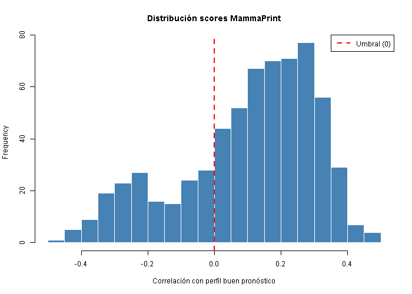
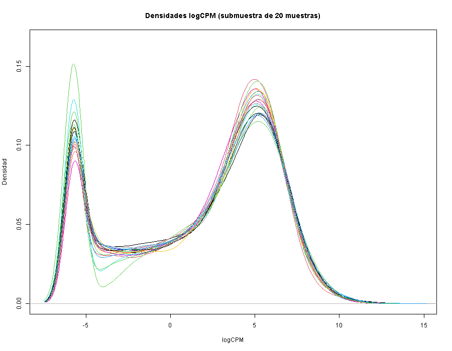
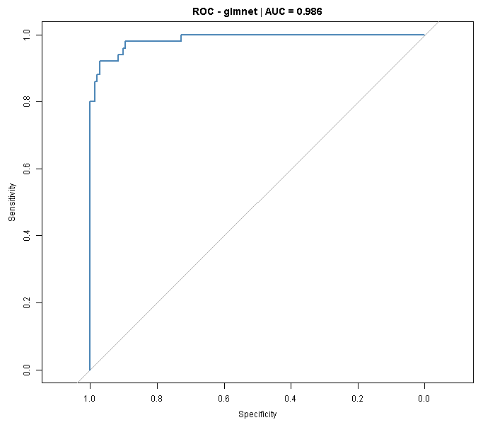

# Predictor sustitutivo de MammaPrint sobre TCGA-BRCA

*[English version](README.md)*

Pipeline en R que reproduce el etiquetado pronóstico de la firma MammaPrint (gene70) sobre datos de RNA-seq de cáncer de mama y entrena después un clasificador capaz de recuperar esas etiquetas a partir del transcriptoma completo.

El trabajo surgió como práctica del Máster Universitario en Bioinformática (Universidad Europea) y se ha revisado y reorganizado para este repositorio.

## Qué hace

El análisis está dividido en dos scripts que se ejecutan en orden.

**`01_mammaprint_labels_and_lasso.R`**

1. Selecciona el subconjunto luminal de la cohorte (ER+ y HER2 no positivo) cruzando la matriz de expresión con la tabla clínica.
2. Normaliza los counts con TMM y los transforma a logCPM (edgeR).
3. Convierte los identificadores de gen a Entrez y colapsa duplicados por media.
4. Calcula un score tipo MammaPrint como correlación de Pearson entre el perfil de cada muestra y el perfil de buen pronóstico del panel gene70 (`genefu`), y lo binariza en alto y bajo riesgo.
5. Reduce a los 1000 genes de mayor varianza, particiona en entrenamiento y test (70/30 estratificado) y entrena un modelo penalizado glmnet con validación cruzada optimizando AUC.
6. Guarda el entorno (`entorno_parte1.RData`) que consume la segunda parte, de modo que la partición se reutiliza y los modelos son comparables entre sí.

**`02_model_comparison.R`**

Reentrena sobre la misma partición cuatro familias de modelos (LASSO, Random Forest, SVM lineal y GBM) con validación cruzada repetida, los compara por AUC y evalúa el mejor sobre el conjunto de validación.

## Datos

No se incluyen en el repositorio. Son datos clínicos y de expresión de la cohorte TCGA-BRCA, y aunque son de acceso abierto, se citan en lugar de redistribuirse.

Los scripts esperan dos archivos en `data/`:

- `BRCA_exp_matrix.tsv`: matriz de counts, genes en filas (símbolo HGNC) y muestras en columnas.
- `clinical_info_TCGA-BRCA.tsv`: tabla clínica con una columna `sample` de identificadores de muestra y las variables `er_status_by_ihc` y `her2_status_by_ihc`.

Se pueden pasar otras rutas como argumentos:

```
Rscript 01_mammaprint_labels_and_lasso.R ruta/expresion.tsv ruta/clinico.tsv [carpeta_salida]
Rscript 02_model_comparison.R [entorno_parte1.RData] [carpeta_salida]
```

Un detalle de la lectura que conviene conocer: el archivo clínico trae una primera columna sin nombre, así que la cabecera tiene un campo menos que las filas de datos. `fread` desplaza los nombres de columna en ese caso y hace que se seleccionen variables equivocadas de forma silenciosa, por lo que el clínico se lee con `read.delim`, que detecta la situación y realinea la cabecera.

## Resultados

Cohorte de partida de 1155 muestras con expresión y 1177 registros clínicos.

**Selección y etiquetado**

| | |
|---|---|
| Muestras luminales (ER+, HER2 no positivo) | 655 en el clínico, 644 con expresión disponible |
| Genes tras mapeo a Entrez | 17.094 de 20.500 |
| Genes del panel gene70 recuperados | 47 de 56 |
| Etiquetas resultantes | 167 alto riesgo / 477 bajo riesgo |



Las densidades de logCPM confirman que la normalización TMM deja las muestras en una escala comparable, con la forma bimodal esperable que separa genes no expresados de expresados.



**Clasificador glmnet (parte I)**

Entrenamiento con 451 muestras y 1000 predictores, validación cruzada de 5 particiones. Los hiperparámetros seleccionados fueron alpha = 0,1 y lambda = 0,069, con un AUC en validación cruzada de 0,976.

Sobre las 193 muestras de test:

| Métrica | Valor |
|---|---|
| AUC | 0,986 |
| Accuracy | 0,943 (IC 95%: 0,900 - 0,971) |
| Sensibilidad (alto riesgo) | 0,820 |
| Especificidad | 0,986 |
| Kappa | 0,845 |



La sensibilidad es claramente inferior a la especificidad, algo esperable con una prevalencia de alto riesgo del 26%: el modelo acierta casi siempre en los casos de bajo riesgo y se le escapan alrededor de uno de cada cinco casos de alto riesgo. En un contexto pronóstico real, ese es el error que más importaría corregir.

**Comparación de modelos (parte II)**

Pendiente de completar con los resultados de `02_model_comparison.R`.

## Estructura

```
.
├── 01_mammaprint_labels_and_lasso.R
├── 02_model_comparison.R
├── figures/                # figuras seleccionadas para este README
├── data/                   # datos de entrada (no versionados)
└── output/                 # resultados generados (no versionados)
    ├── plots/
    └── results/
```

## Notas metodológicas

Tres limitaciones que conviene tener presentes al leer los resultados.

Las etiquetas no son las del test MammaPrint comercial. Se calculan mediante correlación con el perfil de buen pronóstico del panel gene70 disponible en `genefu`, usando los 47 genes que solapan con la matriz de expresión, y el umbral se fija en correlación cero. Es una aproximación al criterio original, no una implementación del test clínico.

El clasificador aprende a reproducir una etiqueta que se deriva de la propia matriz de expresión. Un AUC alto era por tanto previsible y debe leerse como una medida de consistencia interna del pipeline, no como evidencia de valor pronóstico. La pregunta que responde es si un modelo entrenado sobre el transcriptoma completo recupera la señal de un panel de 70 genes, y la respuesta es que sí.

No hay validación externa. Todo el análisis se apoya en una única cohorte, y la partición de test, aunque independiente, procede del mismo conjunto de datos.

## Requisitos

R 4.5.2 en Windows 10. Los scripts instalan las dependencias que falten al ejecutarse.

CRAN: `data.table`, `caret`, `glmnet`, `randomForest`, `e1071`, `gbm`, `pROC`, `ggplot2`, `dplyr`, `doParallel`.

Bioconductor: `edgeR`, `genefu`, `org.Hs.eg.db`, `AnnotationDbi`, `mammaPrintData`.

## Referencias

van 't Veer LJ et al. Gene expression profiling predicts clinical outcome of breast cancer. Nature, 2002.

Gendoo DMA et al. genefu: a package for breast cancer gene expression analysis. Bioconductor.

The Cancer Genome Atlas Network. Comprehensive molecular portraits of human breast tumours. Nature, 2012.

## Autor

José Carlos León Miguel
