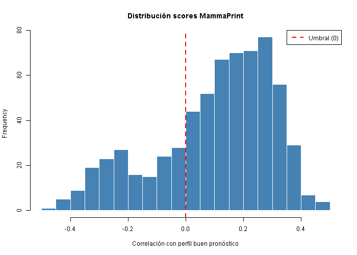
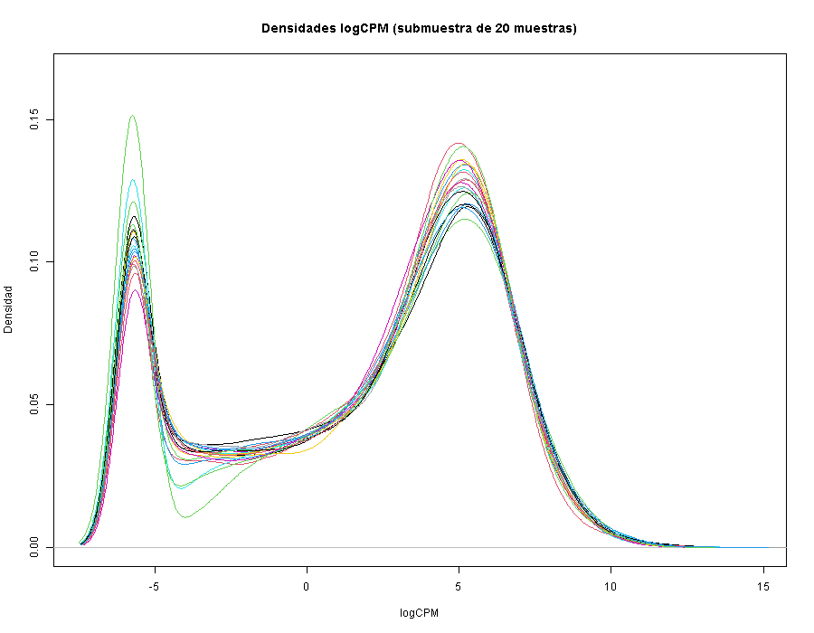
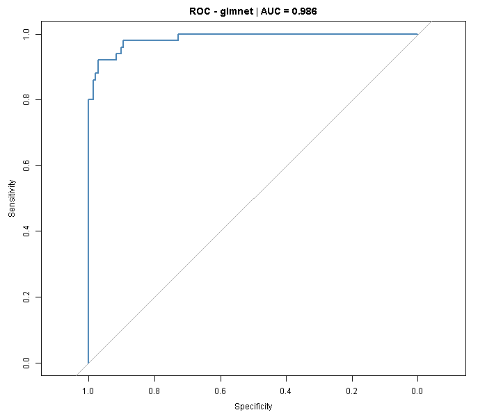

# Surrogate MammaPrint predictor on TCGA-BRCA

*[Versión en español](README.es.md)*

An R pipeline that reproduces the prognostic labelling of the MammaPrint (gene70) signature on breast cancer RNA-seq data, and then trains a classifier that recovers those labels from the full transcriptome.

The work started as a project for the MSc in Bioinformatics (Universidad Europea) and has been reviewed and reorganised for this repository.

## What it does

The analysis runs in two scripts, in order.

**`01_mammaprint_labels_and_lasso.R`**

1. Selects the luminal subset of the cohort (ER positive, HER2 not positive) by matching the expression matrix against the clinical table.
2. Normalises raw counts with TMM and transforms them to logCPM (edgeR).
3. Maps gene identifiers to Entrez and collapses duplicates by mean.
4. Computes a MammaPrint-style score as the Pearson correlation between each sample profile and the good prognosis profile of the gene70 panel (`genefu`), then binarises it into high and low risk.
5. Reduces the matrix to the 1000 most variable genes, splits into training and test sets (70/30, stratified), and trains a penalised glmnet model with cross-validation optimising AUC.
6. Saves the environment (`entorno_parte1.RData`) consumed by the second script, so that the split is reused and the models stay comparable.

**`02_model_comparison.R`**

Retrains four model families on the same split (LASSO, Random Forest, linear SVM and GBM) with repeated cross-validation, compares them by AUC and evaluates the best one on the held-out validation set.

## Data

Not included in this repository. The input is clinical and expression data from the TCGA-BRCA cohort, and although it is open access, it is cited rather than redistributed here.

The scripts expect two files in `data/`:

- `BRCA_exp_matrix.tsv`: count matrix, genes in rows (HGNC symbols) and samples in columns.
- `clinical_info_TCGA-BRCA.tsv`: clinical table with a `sample` column of sample identifiers plus the `er_status_by_ihc` and `her2_status_by_ihc` variables.

Alternative paths can be passed as arguments:

```
Rscript 01_mammaprint_labels_and_lasso.R path/expression.tsv path/clinical.tsv [output_dir]
Rscript 02_model_comparison.R [entorno_parte1.RData] [output_dir]
```

One parsing detail worth knowing about: the clinical file carries an unnamed first column, so its header has one field fewer than its data rows. In that situation `fread` shifts the column names and the wrong variables get selected silently, which is why the clinical table is read with `read.delim`, which detects the case and realigns the header.

## Results

Starting point: 1155 samples with expression data and 1177 clinical records.

**Selection and labelling**

| | |
|---|---|
| Luminal samples (ER+, HER2 not positive) | 655 in the clinical table, 644 with expression available |
| Genes after Entrez mapping | 17,094 out of 20,500 |
| gene70 panel genes recovered | 47 out of 56 |
| Resulting labels | 167 high risk / 477 low risk |



The logCPM densities confirm that TMM normalisation leaves the samples on a comparable scale, with the expected bimodal shape separating unexpressed from expressed genes.



**glmnet classifier (part I)**

Trained on 451 samples and 1000 predictors with 5-fold cross-validation. The selected hyperparameters were alpha = 0.1 and lambda = 0.069, reaching a cross-validated AUC of 0.976.

On the 193 held-out test samples:

| Metric | Value |
|---|---|
| AUC | 0.986 |
| Accuracy | 0.943 (95% CI: 0.900 to 0.971) |
| Sensitivity (high risk) | 0.820 |
| Specificity | 0.986 |
| Kappa | 0.845 |



Sensitivity is clearly lower than specificity, which is what you would expect at a 26% high risk prevalence: the model is almost always right on low risk cases and misses roughly one in five high risk ones. In a real prognostic setting that is the error worth fixing first.

## Repository layout

```
.
├── 01_mammaprint_labels_and_lasso.R
├── 02_model_comparison.R
├── figures/                # figures selected for this README
├── data/                   # input data (not versioned)
└── output/                 # generated results (not versioned)
    ├── plots/
    └── results/
```

## Methodological notes

Three limitations worth keeping in mind when reading the results.

The labels are not those of the commercial MammaPrint test. They are computed by correlating each sample against the good prognosis profile of the gene70 panel shipped with `genefu`, using the 47 genes that overlap with the expression matrix, and thresholding at zero correlation. This approximates the original criterion, it does not implement the clinical assay.

The classifier learns to reproduce a label that is itself derived from the same expression matrix. A high AUC was therefore expected, and it should be read as a measure of the pipeline's internal consistency rather than as evidence of prognostic value. The question it answers is whether a model trained on the full transcriptome recovers the signal of a 70-gene panel, and the answer is that it does.

There is no external validation. The whole analysis rests on a single cohort, and the test split, while held out, comes from that same dataset.

## Requirements

R 4.5.2 on Windows 10. The scripts install any missing dependency on first run.

CRAN: `data.table`, `caret`, `glmnet`, `randomForest`, `e1071`, `gbm`, `pROC`, `ggplot2`, `dplyr`, `doParallel`.

Bioconductor: `edgeR`, `genefu`, `org.Hs.eg.db`, `AnnotationDbi`, `mammaPrintData`.

## References

van 't Veer LJ et al. Gene expression profiling predicts clinical outcome of breast cancer. Nature, 2002.

Gendoo DMA et al. genefu: a package for breast cancer gene expression analysis. Bioconductor.

The Cancer Genome Atlas Network. Comprehensive molecular portraits of human breast tumours. Nature, 2012.

## Author

José Carlos León Miguel
